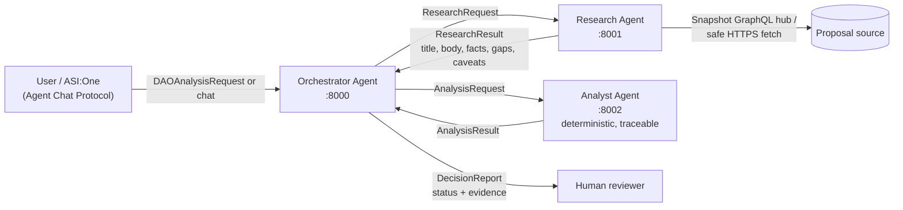

<div align="center">

# DAO-THINK

### A Multi-Agent, Human-in-the-Loop Decision-Support System for DAO Governance

**Three cooperating [uAgents](https://github.com/fetchai/uAgents) · Agentverse Mailbox · ASI:One-ready · Evidence-labelled reports**


*It never votes. It never signs. It never moves funds.*

</div>

---

## Table of Contents

1. [Overview](#overview)
2. [Why Multi-Agent](#why-multi-agent)
3. [Architecture](#architecture)
4. [The Agents](#the-agents)
5. [Tech Stack](#tech-stack)
6. [What the Report Contains](#what-the-report-contains)
7. [Safety and Trust Model](#safety-and-trust-model)
8. [Quick Start](#quick-start)
9. [Tests](#tests)
10. [Local End-to-End Run](#local-end-to-end-run)
11. [Submitting a Proposal](#submitting-a-proposal)
12. [Hosted Deployment (Agentverse Mailbox + ASI:One)](#hosted-deployment-agentverse-mailbox--asione)
13. [Configuration Reference](#configuration-reference)
14. [Troubleshooting](#troubleshooting)
15. [Known Limitations](#known-limitations)
16. [Project Layout](#project-layout)
17. [Roadmap](#roadmap)
18. [Disclaimer](#disclaimer)

---

## Overview

DAO governance proposals are long, dense, and often argued from one side. Reviewers rarely have time to separate **what the source of record says** from **what the proposer claims**.

**DAO-THINK** is a **multi-agent** system that retrieves the real proposal, labels every statement by where it came from, and hands a structured report to a **person** for review. It is decision *support*, not decision *making*:

- It pulls vote data directly from the **Snapshot** API (source of record).
- It copies the proposer's own sentences, clearly prefixed `Proposal says:`, so claims are never presented as verified facts.
- It flags **evidence gaps**, **treasury exposure**, and **prompt-injection text** hidden inside proposals.
- Its strongest output is an escalation to a human. `READY_FOR_HUMAN_REVIEW` is **not** an approval.

---

## Why Multi-Agent

DAO-THINK is not one model with a long prompt. It is **three specialised agents with separate responsibilities, communicating through typed messages**, so each step is isolated, inspectable, and testable.

| Design choice | Benefit |
|---|---|
| **Separation of duties**: retrieval, analysis, and coordination live in different agents | A fetch failure can never silently turn into an "analysis". It becomes an explicit evidence gap |
| **Typed wire models** in a single `shared/models.py` | Every agent-to-agent message is validated; no drifting copies of schemas |
| **Orchestrator validates** every result before reporting | Mismatched IDs, empty bodies, and missing peers are caught and reported |
| **Deterministic Analyst** | Same input gives the same output; every statement is traceable to its origin |
| **Independent deployment** | Each agent has its own seed, address, port, and Agentverse mailbox |

The result is a genuine multi-agent pipeline: **Orchestrator → Research Agent → Orchestrator → Analyst Agent → Orchestrator → Human**.

---

## Architecture



```text
user / ASI:One ──DAOAnalysisRequest or chat──▶ Orchestrator (8000)
                                                │ ResearchRequest
                                                ▼
                                         Research Agent (8001)
                                           Snapshot GraphQL hub / safe HTTPS fetch
                                                │ ResearchResult (title, body, facts, gaps, caveats)
                                                ▼
                                         Orchestrator ──AnalysisRequest──▶ Analyst Agent (8002)
                                                │                         deterministic, traceable
                                                ◀────────AnalysisResult───┘
                                                ▼
                                         DecisionReport (status + evidence) ──▶ human reviewer
```

---

## The Agents

| Agent | Port | Role | Highlights |
|---|---|---|---|
| **Orchestrator** | `8000` | Entry point and coordinator. Speaks the **Agent Chat Protocol** so it can be reached from **ASI:One**. Validates peer results and assembles the final `DecisionReport` | Accepts plain links or JSON, publishes its profile and `AGENT_README.md` to Agentverse |
| **Research Agent** | `8001` | Retrieves the real proposal | Snapshot GraphQL hub, safe HTTPS fetch, SSRF checks, bounded HTTP, detects client-rendered pages |
| **Analyst Agent** | `8002` | Turns evidence into a structured assessment | Deterministic statement extraction, prompt-injection detection, treasury-exposure risk, evidence critique |

A fourth process, the **test client** on port `8003`, simulates a user for local end-to-end runs.

---

## Tech Stack

- **[Fetch.ai uAgents](https://github.com/fetchai/uAgents)**: the agent framework behind all three agents
- **Agentverse Mailbox**: lets locally running agents be reachable from the hosted network without public endpoints
- **ASI:One**: chat with the Orchestrator through the **Agent Chat Protocol**
- **Snapshot GraphQL API**: source of record for vote data
- **Python 3.10+**, `pydantic` typed messages, `pytest` for offline tests

---

## What the Report Contains

Every item is labelled with where it came from, so a reviewer always knows how much to trust it.

| Section | Source | Trust level |
|---|---|---|
| **Facts from the source of record** | Snapshot API (space, id, state, choices, voting window, vote totals, quorum) | Source of record for vote data |
| **Stated purpose, benefits, dependencies, amounts** | Sentences copied from the proposal, prefixed `Proposal says:` | The proposer's claims, **not verified** |
| **Risks** | Risk statements in the proposal + treasury-exposure notes + caller-figure checks | Mixed, each item labelled |
| **Evidence gaps** | Anything that blocks reliance (retrieval failure, empty body, title/ID mismatch, amounts without treasury figures) | Status becomes `MORE_EVIDENCE_REQUIRED` |
| **Caveats** | Non-blocking uncertainty (vote totals are not merit, quorum 0 means not configured, truncation) | Shown, does not block |
| **Assumptions** | The Analyst's own method limits | n/a |

**Recommendations are limited to three outcomes:**

- `DEFER_PENDING_EVIDENCE`
- `ESCALATE_FOR_REVIEW` (high treasury exposure or prompt-injection text)
- `HUMAN_REVIEW_REQUIRED`

---

## Safety and Trust Model

- **Never votes, signs, or moves funds.** There is no wallet, no signing key, and no transaction code path.
- **No guessed numbers.** `DAO_REQUESTED_AMOUNT` and `DAO_TREASURY_BALANCE` are only used if you supply them.
- **Claims stay claims.** Proposer statements are always prefixed `Proposal says:`.
- **Failures are visible.** Retrieval failures become evidence gaps, never silent analysis.
- **Prompt-injection aware.** Suspicious instructions embedded in proposal text trigger escalation.
- **SSRF protection.** DNS is validated before connecting, and redirects are refused (see [Known Limitations](#known-limitations)).
- **Secrets stay local.** `.env`, `private_keys.json`, and key files are git-ignored; the seed helper never prints seeds.

---

## Quick Start

**Requirements:** Python 3.10+ on macOS or Linux.

```bash
# 1. Create and activate a virtual environment
python3 -m venv .venv
source .venv/bin/activate

# 2. Install dependencies
python -m pip install --upgrade pip
python -m pip install -r requirements.txt

# 3. Generate .env with 4 fresh, distinct seeds (never printed)
python scripts/new_local_env.py
```

Open `.env` and set the proposal to test. **Quote the URL**, because Snapshot URLs contain `#`:

```env
DAO_PROPOSAL_URL="https://snapshot.org/#/<space>/proposal/<proposal-id>"
DAOTHINK_LOCAL=1
```

> Leave `DAO_REQUESTED_AMOUNT` and `DAO_TREASURY_BALANCE` blank unless you know the real figures. DAO-THINK never guesses them.

<details>
<summary><b>Windows (PowerShell)</b></summary>

Activate the environment with `.\.venv\Scripts\Activate.ps1` and use `Copy-Item` instead of `cp`. The end-to-end shell script is macOS/Linux only, so start the agents manually (see [Manual alternative](#local-end-to-end-run)).

</details>

---

## Tests

```bash
python -m pytest -q
```

All unit tests are **offline**: network calls and DNS are mocked or blocked. A passing run proves the logic, not live connectivity. The optional hosted mailbox test (`tests/test_analysis_agent_integration.py`) skips unless you configure it.

---

## Local End-to-End Run

One command starts the **Research, Analyst and Orchestrator** agents, sends your proposal from a test client on port `8003`, checks the report, and stops the agents:

```bash
./scripts/run_local_e2e.sh "https://snapshot.org/#/<space>/proposal/<proposal-id>"
```

It **passes only if**:

- a `DecisionReport` arrives for the same `proposal_id`,
- the proposal content was actually retrieved,
- the requested URL appears among the sources, and
- the Analyst produced a stated-purpose summary.

Logs are written to `logs/e2e-*/`.

**Manual alternative** (four terminals, repository root, venv active):

```bash
python -m research_agent.research_agent   # terminal 1, port 8001
python -m analyst.agent                   # terminal 2, port 8002
python -m orchestrator.agent              # terminal 3, port 8000
python -m tests.send_local_request        # terminal 4, port 8003
```

If a port is busy, find the stale process:

```bash
lsof -nP -iTCP:8000 -sTCP:LISTEN
```

---

## Submitting a Proposal

In **ASI:One** chat (or any Agent Chat Protocol client), send either a plain link:

```text
Please review https://snapshot.org/#/<space>/proposal/<proposal-id>
```

or JSON:

```json
{
  "proposal_id": "<id>",
  "proposal_url": "https://snapshot.org/#/<space>/proposal/<id>",
  "requested_amount": 250000,
  "treasury_balance": 10000000
}
```

`proposal_title` is optional. If supplied and it differs from the retrieved title, the report flags the mismatch.

---

## Hosted Deployment (Agentverse Mailbox + ASI:One)

> Local success is not proof of hosted success. Test the hosted path separately.

1. In `.env`, set `DAOTHINK_LOCAL=0` and `MAILBOX_ENABLED=true`. Use fresh seeds.
2. Start each agent on your machine (ports `8000` / `8001` / `8002` stay distinct). Each logs an **Agent Inspector** URL.
3. Open each Inspector URL in a browser signed in to **Agentverse**, then click **Connect → Mailbox**. Each agent needs its **own** mailbox.
   Chrome 142+ and Brave ask for *Local Network Access*; click **Allow**, or the Inspector cannot see the local agent.
4. Wait for `Successfully registered as mailbox agent in Agentverse` in each log.
5. Set `RESEARCH_AGENT_ADDRESS` and `ANALYSIS_AGENT_ADDRESS` to the addresses the agents print (or leave blank to derive them from the seeds), then restart the Orchestrator.
6. In Agentverse, check the Orchestrator's profile (name, description and `AGENT_README.md` are published automatically) and that it shows as **active**.
7. Test agent-to-agent delivery, then chat with the Orchestrator from **ASI:One** using a real proposal link. Only call it hosted/ASI:One-ready after that works.

Agents must keep running to stay reachable. Nothing here spends funds; if any step asks for tokens or payment, stop and check the event's official instructions.

---

## Configuration Reference

See [`.env.example`](.env.example) for every option. Key variables:

| Variable | Purpose |
|---|---|
| `DAOTHINK_LOCAL` | `1` for local resolver and seed-derived addresses; `0` for hosted |
| `MAILBOX_ENABLED` | `true` to connect agents through the Agentverse mailbox |
| `DAO_PROPOSAL_URL` | Proposal used by the test client and E2E script (quote it) |
| `DAO_REQUESTED_AMOUNT` / `DAO_TREASURY_BALANCE` | Optional caller-supplied figures; never guessed |
| `RESEARCH_AGENT_ADDRESS` / `ANALYSIS_AGENT_ADDRESS` | Peer addresses; blank derives them from seeds |

**Secrets:** never commit `.env`, `private_keys.json`, or key files (`.gitignore` covers them). If a seed has been shared, rotate it:

```bash
python scripts/new_local_env.py --rotate
```

Agent addresses change as a result.

---

## Troubleshooting

| Symptom | Likely cause and fix |
|---|---|
| `MORE_EVIDENCE_REQUIRED` with a retrieval gap | No internet, bad URL, or a client-rendered page. This is reported on purpose, not a crash |
| Port already in use | `lsof -nP -iTCP:8000 -sTCP:LISTEN`, then stop the stale process |
| URL ignored or truncated | Quote `DAO_PROPOSAL_URL` in `.env`, because `#` starts a comment otherwise |
| Inspector cannot see the local agent | Allow Local Network Access in Chrome 142+ / Brave |
| Hosted delivery fails on a long proposal | Lower `MAX_PROPOSAL_CHARS` in `research_tools.py` |
| Peers not found after changing seeds | Re-set `RESEARCH_AGENT_ADDRESS` / `ANALYSIS_AGENT_ADDRESS` and restart the Orchestrator |

---

## Known Limitations

We list these openly so reviewers know exactly what has and has not been verified.

- Statement classification is **keyword-based**; it can miss or misfile sentences.
- Only **Snapshot** (`snapshot.org` / `snapshot.box` mainnet hub) is read through an API. Other URLs are fetched as HTML; client-rendered pages are detected and reported as not retrieved rather than analyzed.
- The forum/discussion link is listed but not fetched.
- Amounts are quoted, not converted or priced; treasury balance must be supplied.
- SSRF protection validates DNS before connecting and refuses redirects, but does not pin the resolved IP (a DNS-rebinding window remains).
- Agents handle one message at a time; a slow retrieval delays other requests.
- Agentverse mailbox message-size limits were not verified.

See [`VALIDATION.md`](VALIDATION.md) for what has and has not been verified.

---

## Project Layout

| Path | Purpose |
|---|---|
| `shared/models.py` | The only wire-model definitions (not copied into agents) |
| `research_agent/research_tools.py` | URL safety, bounded HTTP, Snapshot GraphQL, evidence building |
| `research_agent/research_agent.py` | Research uAgent |
| `analyst/evidence.py` | Deterministic statement extraction and injection detection |
| `analyst/strategy.py`, `critic.py`, `risk.py` | Assessment, evidence critique, treasury exposure |
| `analyst/agent.py` | Analyst uAgent |
| `orchestrator/agent.py`, `report.py` | Coordination, validation, chat protocol, report |
| `local_config.py` | Ports, seed-derived addresses, local resolver |
| `scripts/` | `.env` seed helper and local end-to-end script |
| `tests/` | Offline unit, pipeline and edge-case tests; demo client |
| `AGENT_README.md` | Agentverse profile text |
| `VALIDATION.md` | What has and has not been verified |

---

## Roadmap

- Support more governance sources beyond Snapshot (e.g. on-chain governors and forums)
- Fetch and analyse linked discussion threads
- Price and convert requested amounts against live treasury data
- Richer, model-assisted statement classification while keeping every claim traceable
- Streaming and concurrent request handling across the agent pool

---

## Disclaimer

DAO-THINK is **not affiliated with or endorsed by Fetch.ai or Snapshot**. Its output is **not financial, legal, or governance advice**. A human must make every decision.

<div align="center">

**Built with Fetch.ai uAgents · Agentverse Mailbox · ASI:One**

*Three agents. One evidence-labelled report. A human makes the call.*

</div>
